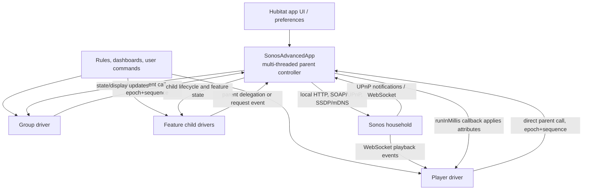
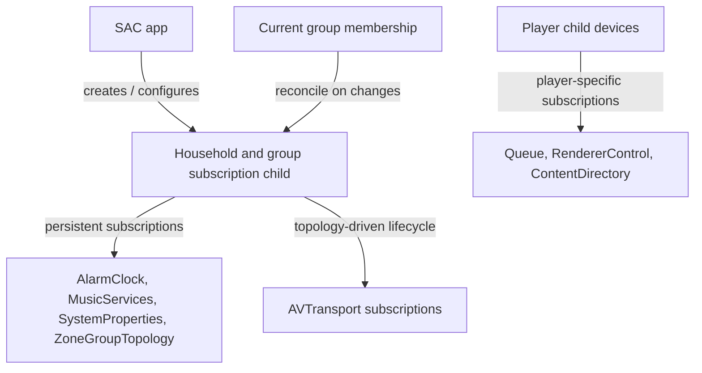

# Sonos Advanced Architecture

> Working map of the implementation in this repository as of 2026-11-24. This describes current code to support design iteration; it is not a promise that every current boundary is the desired long-term design.

## Scope and package shape

Sonos Advanced is a Hubitat package in the `dwinks` namespace. HPM metadata is in `PackageManifests/SonosAdvancedController/packageManifest.json`. The production app and drivers are standalone Groovy files; the root `Bundles/` directory is generated and must not be edited by hand.

| Part | Current responsibility |
| --- | --- |
| `Apps/SonosAdvancedApp.groovy` | Parent controller: UI and configuration, local discovery, Sonos protocol/network work, child-device lifecycle, state fanout, grouping, announcements, alarms, updates and package maintenance. It is `singleThreaded:true`. |
| `Drivers/Component/SonosAdvPlayer.groovy` | Primary speaker device commands, playback state, WebSocket connection/command handling, and player-to-app request/state callbacks. |
| `Drivers/Component/SonosAdvGroup.groovy` | Configured logical groups and group-level commands/announcements. It maintains group runtime state and calls the app directly. |
| `Drivers/Component/SonosAdvSecondaries.groovy` | Secondary/paired speaker representation and related topology/device data. |
| `Drivers/Component/SonosAdvSnapshot.groovy` | Snapshot/restore command surface delegated to the parent app. |
| `Drivers/Component/SonosAdvFavorites.groovy`, `SonosAdvPlaylist.groovy` | Favorite and playlist controls and display state, delegated to the app. |
| `Drivers/Component/SonosAdvQueue.groovy`, `SonosAdvSleepTimer.groovy` | Queue and sleep timer control/display surfaces delegated to the app. |
| `Drivers/Component/SonosAdvAlarmManager.groovy`, `SonosAdvAlarmSwitch.groovy` | Household alarm manager and per-alarm switch devices; requests are sent to the app. |
| `Drivers/Component/SonosAdvBatteryStats.groovy` | Battery-statistics component state delivery. |
| `Bundles/SonosAdvancedController/dwinks.SMAPILibrary.groovy` | Legacy Sonos service/action definitions and SOAP/event helper implementation, distributed as a Hubitat library. The app does not declare a source-level include; verify how the installed package/library workflow supplies methods before changing this dependency. |

The app currently contains both end-user Sonos functionality and administrative package tooling (version checks, update/install, driver/library publishing, and duplicate cleanup). These are separate responsibilities in code, but not separate runtime components.

## Runtime topology

The app is the household coordinator and owns most authoritative integration workflows. Player drivers own the live player socket and command semantics that need to remain close to a device. Drivers expose Hubitat capabilities and commands, but many feature commands forward to the parent for household context or local Sonos operations.

## Planned subscription child

The target design adds a dedicated child device owned by the Sonos Advanced Controller (SAC) app. This child owns and processes household-level and group-level UPnP event subscriptions. It provides one place to manage subscription lifetimes and handle event notifications that describe shared household topology or state.

| Subscription service | Owner in target design | Lifetime |
| --- | --- | --- |
| `/AlarmClock/Event` | Subscription child | Maintained continuously |
| `/MusicServices/Event` | Subscription child | Maintained continuously |
| `/SystemProperties/Event` | Subscription child | Maintained continuously |
| `/ZoneGroupTopology/Event` | Subscription child | Maintained continuously |
| `/MediaRenderer/AVTransport/Event` | Subscription child | Created and destroyed as group membership changes |
| `/MediaRenderer/Queue/Event` | Player device | Maintained on each player device |
| `/MediaRenderer/RendererControl/Event` | Player device | Maintained on each player device |
| `/MediaServer/ContentDirectory/Event` | Player device | Maintained on each player device |

The continuously maintained subscriptions are household/group scope and remain active regardless of current group membership. AVTransport is the exception: its subscriptions follow active group membership and must be reconciled when topology changes, creating subscriptions for the relevant group-level targets and removing subscriptions that are no longer needed. The precise AVTransport target selection and whether a group is represented by its coordinator or by another target should follow the existing event semantics and be specified before implementation.

Queue, RendererControl, and ContentDirectory events remain on player devices because they are player-specific. Moving household/group subscriptions into the new child must not duplicate these player subscriptions or make the subscription child responsible for player-only state.

This is planned architecture. The current source has app-side UPnP subscription and notification processing; it does not yet implement this dedicated subscription child. During migration, document which app responsibilities move, the child-to-app event/data contract, subscription renewal/recovery behavior, and how current persisted subscription identifiers are handled.

## Main data and protocol paths

### Discovery and child lifecycle

The app discovers players through SSDP and mDNS, stores temporary discovery results, and presents selection/configuration pages. Identifiers are reconciled across MAC, RINCON/player ID, IP, and Hubitat DNI to avoid duplicate devices. A quick topology query can enrich discovered device properties. Selected primary players are created as player children; secondary speakers and optional feature children are managed from topology/configuration and preferences. Lifecycle/configuration logic subscribes to child request/state events and arms schedules and refresh work.

The app persists configured device selections and user-defined groups in settings/state. A whitelist of active persistence keys is used to prune orphaned persisted values on save, with explicit migration handling for selected legacy keys. Treat existing setting/state names as install data, not private implementation details.

### Playback state

Player WebSocket events update the player driver. The driver reports playback state to the app by calling the app directly (each payload carries `[epoch, sequence]`). The app's entry point accepts it (dropping anything not newer than the last accepted for that stream) and schedules one `runInMillis` callback that applies the attributes to the player and group children, skipping any attribute a newer report already applied. Unchanged values are skipped by Hubitat's event filtering. Group playback state is derived from coordinator/topology context and published separately from raw per-player state. Track-position updates are optional.

UPnP AVTransport/RenderingControl events and ZoneGroupTopology (ZGT) observations also feed app-side state/topology processing. Cached AVTransport state can be replayed when a player becomes a coordinator. Album-art URLs are normalized/resized at fanout. Avoid adding a second source of truth for attributes without defining precedence against WebSocket and UPnP ownership.

### Commands and concurrency

Player and group drivers call the app directly. A child entry point (listed in the app's `CHILD_ENTRY_POINTS`) only reads and writes app data, reads child wrappers and calls `asynchttp*`, then returns (the return value is the acknowledgement) or ends with a single `runInMillis(1, '<callback>', [data: ..., overwrite: false])`; any write to a child happens in that callback. There is no driver outbox, app queue, drain, received-ID dedupe or ack/retry loop for child-to-app traffic. Group commands may be deferred behind active topology operations; playback commands can wait for grouping to settle. Grouping itself is a stateful operation: the app builds a target, sends topology commands, observes fresh topology, checks stability/deadlines/retries, and publishes completion/failure.

The app, `SonosAdvPlayer` and `SonosAdvGroup` are `singleThreaded: false`, so no member of this family holds an execution gate while waiting for another; the 120 s gate-timeout deadlock cannot form. The Discovery, Favorites and Playlists child apps stay `singleThreaded: true` and wait on nothing. Because callbacks and executions run in parallel, order comes from numbers rather than queues: every ordered stream carries a driver-stamped `[epoch, sequence]` (per-DNI `AtomicLong`, `DRIVER_EPOCH` set at class load) and the app checks it at the entry point (accept gate) and again in the callback (apply gate), per attribute or event name for partial payloads. Absolute commands (transport, volume, mute, repeat, shuffle, crossfade, set track) are latest-wins per target and family; additive commands (group membership, line-in, favorite/playlist loads, announcements) keep arrival order.

Data follows one of three storage patterns per key. `state` commits per changed key, so a read-modify-write of one key loses updates even inside a lock; `state` is therefore only for overwrite-only or single-writer keys. Shared read-modify-write and recoverable work state (preference snapshots, ZGT election list, active group operation, deferred operation commands) live in `atomicState` through `mutateAppData` (a per-key static lock). Re-derivable caches and transient work (AVT cache, volume readings, GRC, announcement and clip queues, catalog snapshots, sequence marks) live in `@Field static ConcurrentHashMap` working data keyed by `app.id` under `appLock(key)`, and are emptied by a reboot or code save. Group operation, announcement and clip work share one `appLock('work')`. A driver at `singleThreaded: false` keeps hot queues in `@Field static ConcurrentHashMap` (`runtimeState`) with `synchronized(runtimeState)` read-modify-write. The `ConcurrencyRule` lint enforces pure entry points, the key access paths, no `synchronized` method modifiers, and no pure parent hops in drivers. Keep bridge traffic out of attributes: user-visible attributes represent product state, not internal transport.

### Announcements and audio clips

The app owns per-group announcement queues and policy, including priority, retention, chime behavior, and serialization. It selects a playback strategy based on the source and current household topology: standard stream/temporary stream holder or synchronized audio clips; AirPlay bypasses stream-holder handoff. Audio clip work is queued per player and dispatched to a local app endpoint, with callbacks/status events driving progression. Group announcement progress is correlated back to queue items; completion restores playback/topology as applicable before advancing. Queue state is app memory; correlation identifiers reject stale work.

Preserve the separation between command acceptance, clip/announcement progress, restore completion, and queue advancement. These are asynchronous transitions, not one synchronous operation. Announcement and clip queues live in app memory (a reboot or code save empties them and drops pending announcements), so there is no persisted queue to recover; stale callbacks are rejected by correlation ID and sequence.

### Alarms and feature children

Alarm management is opt-in. The app communicates with the local Sonos AlarmClock UPnP service, refreshes household alarms, and manages one alarm switch per alarm plus a household Alarm Manager device. Alarm drivers send requests; state updates are batched. Favorites, playlists, queue, sleep timer, snapshot, and secondary devices are smaller child-facing surfaces whose Sonos context/actions are largely coordinated by the app.

### Network control and maintenance

Local Sonos control is implemented in the app using asynchronous HTTP/SOAP requests, UPnP event subscriptions, WebSocket/topology flows, retry metadata, and response validation. Request callbacks carry identifiers/context so stale responses can be ignored. The SMAPI library in the bundle defines service maps and SOAP/event helpers; the app also has a substantial local HTTP/retry boundary.

The same app includes optional update checking and installation/maintenance flows that authenticate to the Hubitat hub, inspect installed app/driver/library code, compare package versions, upload updates, publish libraries, and clean duplicates. These flows are administrative and should remain isolated from playback/discovery state changes if the app is reorganized.

## State ownership (current)

| Data | Primary owner | Notes |
| --- | --- | --- |
| User configuration (selected players/groups, feature toggles, announcement and update preferences) | App `settings` | Preference names/types are compatibility-sensitive. |
| Discovery in progress and probe counters | App `atomicState` | Low-frequency discovery coordination. |
| Pending app work: announcement and clip queues, AVT/GRC/reading caches, catalog snapshots, sequence marks | App memory (`@Field static ConcurrentHashMap`) under `appLock` | Multi-threaded app; emptied by reboot or code save; subscriptions refill the caches. |
| Recoverable work: active group operation, deferred operation commands, preference snapshots, ZGT election list | App `atomicState` through `mutateAppData` | Per-key lock; survives reboot so a group operation can recover. |
| Live socket, pending WebSocket commands, hot player queues, request tokens and playback readings | Player driver `runtimeState` / static concurrent structures; driver `state` keeps only last-error diagnostics | Some hot concurrent paths require lock-protected in-memory queues. Check each driver before relocating data. |
| Current product attributes | Child driver state/events | App delivers state batches; driver attributes are visible to Hubitat users and automations. |
| Group runtime cache / operation state | Group driver plus app operation state | Group driver sends commands directly; app owns topology orchestration. |

The tables above are a map, not a complete schema. The `ACTIVE_*` whitelists in the app and drivers are the code-level inventory of deliberately retained persistence keys.

## Refactoring boundaries and invariants

These are constraints visible in the implementation and repository guidance; proposed design changes should make any deliberate change explicit.

1. **Keep Hubitat entry points short.** Child-to-app entry points only touch app data and return, or schedule one `runInMillis` callback for any child write. Network callbacks and player parsing stay short.
2. **Preserve parent-child contracts as a unit.** App and driver releases are version-synchronized. Change both sides together; do not add old-version fallback shims.
3. **Preserve persisted names or migrate intentionally.** Settings and state can survive code updates on installed hubs. A rename/removal needs an explicit migration and tests.
4. **Keep state provenance clear.** Define the owner and freshness/precedence of WebSocket, UPnP, topology, and derived group values before splitting or duplicating processing.
5. **Keep asynchronous operations explicit.** Requests, acknowledgements, callbacks, deadlines, retries, queue progression, and stale-work cancellation are observable states that need their own contracts.
6. **Bound fanout.** Preserve batching/coalescing for app-to-child delivery to avoid long lock holds and excess event writes.
7. **Keep production artifacts standalone where practical.** New app/driver code should not introduce shared-library includes. Existing library/package behavior is legacy and should be migrated only with an explicit compatibility plan.
8. **Keep protocol parsing and pure transformations separable.** Typed parsers, formatters, and calculations are good candidates for isolated helpers and regression tests; Hubitat APIs and dynamic device dispatch belong at narrow edges.
9. **Do not edit generated bundles.** Update source and package metadata/workflows as appropriate; let CI regenerate `Bundles/`.

## Current code seams to iterate on

These are candidate seams inferred from the current file layout, not a prescribed target architecture:

- The app is roughly 12,000 lines and combines UI, discovery, protocol transport, event processing, command queues, group operation state machines, announcements, alarms, and package administration. Its section boundaries are the likely first decomposition map.
- App-to-child delivery still has a coalescing queue for group state (`drainGroupStateUpdates`); with everything ungated it can become a direct `sendEvent` in a later change. The Alarm Switch, Alarm Manager and Discovery children have not yet been audited against the child-entry-point rule.
- State ingestion spans player WebSocket callbacks and app-side UPnP/ZGT processing. A normalization/ownership map should precede extraction to avoid races or stale overwrites.
- Group topology operations and announcement restoration both observe/change household topology. Their coordination boundary and cancellation behavior deserve explicit state diagrams before moving code.
- The app mixes user control with Hubitat code maintenance and self-update behavior. These can be documented and tested as separate subsystems even while hosted by one app.
- `SMAPILibrary` remains a large legacy protocol catalog/helper. Decide whether it is a maintained package dependency or a future inline/extracted protocol module; do not assume the source-level app alone shows deployment behavior.
- The planned subscription child creates a new protocol ownership boundary: household/group event subscriptions and notification processing move there, while the player driver retains Queue, RendererControl, and ContentDirectory subscriptions. AVTransport subscription lifecycle must track group topology dynamically.

## Useful code and test entry points

- Main controller: `Apps/SonosAdvancedApp.groovy`
- Player and group behavior: `Drivers/Component/SonosAdvPlayer.groovy`, `Drivers/Component/SonosAdvGroup.groovy`
- Secondary/topology device: `Drivers/Component/SonosAdvSecondaries.groovy`
- Protocol definitions: `Bundles/SonosAdvancedController/dwinks.SMAPILibrary.groovy`
- Package inventory/version: `PackageManifests/SonosAdvancedController/packageManifest.json`
- App and player specs: `tests/src/test/groovy/dwinks/hubitat/functional/SonosAdvancedAppSpec.groovy`, `SonosAdvPlayerSpec.groovy`
- Group and feature specs: sibling `SonosAdv*Spec.groovy` files in `tests/src/test/groovy/dwinks/hubitat/functional/`
- Existing behavior notes: `Readme/SonosAdvanced-Playback-Volume.md` and `Readme/SonosFavorites-README.md`

When refining this document, record the intended target separately from current behavior, then update the relevant contracts, persistence migration plan, and regression coverage as design decisions become firm.
